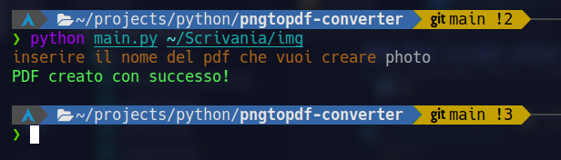
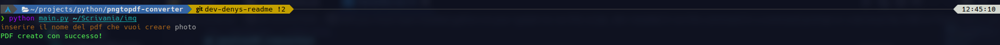

# pngtopdf-converter
### This script lets you convert an entire folder of PNG or JPG images into a PDF file
- You can also check for missing dependencies, and the script will tell you if you're missing any at runtime. 

## INSTALLATION
---
### If the script doesn't run because some dependencies are missing, run the following command to install them.

-   <p style="color: #ff000"> You must first change directory to the project directory! </p>
```
    pip install --user -r dependencies/requirements.txt
```

## USAGE
---
### You need to have python installed on your system to run this script, and then use this command in a shell (like CMD or PowerShell in windows).

```
    python main.py path/to/img/directory
```

## CONTACT
---
<center>
  <table border=0>
    <tr>
      <td>
        <a href="https://github.com/D3ENNY">
          
        </a>
      </td>
      <td>
        <a href="mailto:denysraimondi06@gmail.com">
          
        </a>
      </td>
        <td>
          <a href="https://t.me/D3ENNY04">
            
          </a>
      </td>
    </tr>
    <tr>
      <td>github</td>
      <td>email</td>
      <td>telegram</td>
    </tr>
  </table>
</center>

## SUPPORT ME
---
If you want support me or my projects you can give me a little donation here:
<center>
  <table border=0>
    <tr>
      <td>
        <a href="https://paypal.me/denysraimondi">
          
        </a>
      </td>
      <td>
        <a href="https://www.buymeacoffee.com/D3ENNY">
          
        </a>
      </td>
    </tr>
    <tr>
      <td>paypal</td>
      <td>Buy Me A Coffee</td>
    </tr>
  </table>
</center>
    
